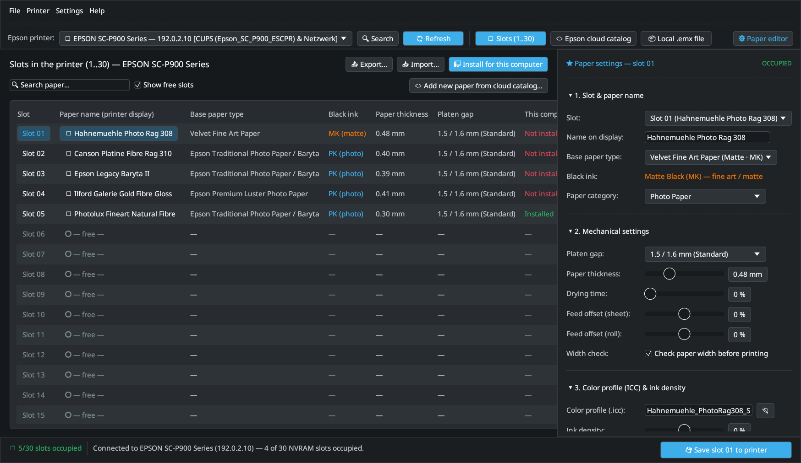

<p align="center"></p>

# `EP Media Installer` (`epmi`)

Native Rust Custom Media & `.emx` Management Tool for **Epson SureColor** Fine Art & Large Format Printers (SC-P900, SC-P700, SC-P5300, SC-P7500, SC-P9500, SC-T Series, and more).

> **Disclaimer:** `EP Media Installer` (`epmi`) is an independent, clean-room open-source utility and is not affiliated with, endorsed by, or sponsored by Seiko Epson Corporation. Product names are used solely for compatibility reference.

> [!WARNING]
> **Beta.** Tested on Fedora with an Epson SureColor **SC-P900**: discovering the printer, reading the
> 30 custom media slots, the cloud catalog, `.emx` import and “Install for this computer” together
> with [epson-p900-escpr-cups](https://github.com/colorcube/epson-p900-escpr-cups). Writing and clearing
> slots changes the printer's memory – the other SureColor models are listed from Epson's cloud data but
> have not been tested. The user interface is available in English and German (follows the system
> language, switchable under *Settings → Language*).



## Documentation

Online manual: **[English](https://colorcube.github.io/ep-media-installer/manual/)**

---

## Workspace Architecture

```text
ep-media-installer/
├── crates/
│   └── epmi-core/   # 100% GUI-free Rust library (CUPS + SNMP printer discovery, NVRAM slots 1..30, .emx parser, 27-model Cloud client, custom_media.json sync)
└── apps/
    ├── epmi/        # Fast CLI binary (`epmi discover`, `epmi list-slots`, `epmi sync`, `epmi cloud-models`, `epmi cloud-list`, ...)
    └── epmi-gui/    # Native egui/eframe desktop GUI (`epmi-gui`)
```

### Integration with [`epson-p900-escpr-cups`](https://github.com/colorcube/epson-p900-escpr-cups) and [`LumaPrint`](https://github.com/colorcube/lumaprint)

Like Epson's own software on Windows/macOS, custom media live in two places: the **printer**
stores the mechanical settings in its 30 NVRAM slots, every **computer** that prints needs the
paper list and the ICC profiles locally. Epson's FAQ: the Media Installer must run on every
computer.

| What | Where | Written by |
|---|---|---|
| Mechanical settings, media ID | printer NVRAM slot `1..30` | `epmi` (SNMP) |
| Working copy (per user) | `~/.config/epson-p900-escpr/custom_media.json`, profiles in `~/.local/share/color/icc/epson-scp900/` | `epmi` |
| System paper list (CUPS filter, PPD, LumaPrint) | `/etc/epson-p900-escpr-cups/custom_media.json` | driver helper, via **“Install for this computer”** |
| System colour profiles | `/usr/local/share/color/icc/epson-p900-custom/` | driver helper |

**“Install for this computer”** (GUI button, CLI `epmi install-system`) reads the printer's slots,
fetches the profiles of Epson cloud media automatically (the slot's media ID equals the cloud
`.emx` ID), and hands the list to the privileged helper of the driver
(`pkexec /usr/libexec/epson-p900-escpr-cups/epson-p900-media-install`, administrator password).
The helper installs list and profiles and refreshes the PPDs of all CUPS queues of the driver.
Requires [`epson-p900-escpr-cups`](https://github.com/colorcube/epson-p900-escpr-cups) to be installed.

Papers that are not in the Epson cloud (e.g. third-party papers) get their profile assigned once
(GUI: 📂 next to *Color profile* / *Farbprofil*, CLI: `--icc <SLOT>=<FILE.icc>`). To set up a second computer,
export them (`.epmi` archive with profiles) and import them there.

| Project | Version | Compatible With | Role |
| :--- | :--- | :--- | :--- |
| **`ep-media-installer` (`epmi`)** | `0.1.x` | `epson-p900-escpr-cups >= 0.3.0`<br>`LumaPrint >= 0.1.0` | Reads/writes the 30 NVRAM slots via SNMP, imports `.emx` / cloud media, and installs papers + ICC profiles system-wide |
| **[`epson-p900-escpr-cups`](https://github.com/colorcube/epson-p900-escpr-cups)** | `0.3.x` | `ep-media-installer >= 0.1.0`<br>`LumaPrint >= 0.1.0` | Native Rust CUPS filter (`rastertop900escpr`), dynamic PPD generator, and privileged helper `epson-p900-media-install` |
| **[`LumaPrint`](https://github.com/colorcube/lumaprint)** | `0.1.x` | `epson-p900-escpr-cups >= 0.3.0`<br>`ep-media-installer >= 0.1.0`<br>Any CUPS queue | 16-bit Fine-Art print layout, live softproofing, and Advanced B&W studio; automatically loads installed custom media |

---

## Supported Systems & Requirements

- **Distributions:** Developed and tested on Fedora 43/44 (KDE Plasma 6); works on Debian 13+, Ubuntu 24.04+, Arch Linux, openSUSE Tumbleweed, and other modern Linux distributions.
- **Display Server (`epmi-gui`):** **Wayland** and **X11** (`eframe`/`winit` with OpenGL/Mesa). The `epmi` CLI runs headless without a display server.
- **CUPS & Polkit:** CUPS `>= 2.3` (`lpstat` for automatic queue discovery) and `polkit` (`pkexec` + a running desktop polkit authentication agent for *“Install for this computer”*).
- **Network:** Local network reachability to the printer via **SNMPv1 (`UDP 161`)** for reading/writing the 30 NVRAM slots, and HTTPS (`TCP 443`) for browsing/downloading from the Epson cloud media catalog.
- **Rust Toolchain (for building from source):** `>= 1.85` (Rust 2024 Edition).

---

## CLI Usage (`epmi`)

### 1. Automatically discover Epson printers (CUPS + local network SNMP)

```bash
cargo run -p epmi -- discover
```

### 2. List custom media slots (`1..30`) from the printer

```bash
# Automatically discovers the Epson printer on the network if --host is omitted:
cargo run -p epmi -- list-slots
```

### 3. Install the printer's papers for this computer

```bash
# State of each slot on this computer and its colour profile:
cargo run -p epmi -- status

# Install paper list + profiles for the CUPS driver and LumaPrint (asks for the admin password);
# assign an own profile to slot 2 on the way:
cargo run -p epmi -- install-system --icc 2=Hahnemuehle_PhotoRag308.icc

# Move papers with their profiles to another computer:
cargo run -p epmi -- export -o my-papers.epmi
cargo run -p epmi -- import my-papers.epmi      # on the other computer, then install-system
```

### 4. Inspect or import a local `.emx` package

```bash
# Inspect XML, CPB, and ICC metadata inside an .emx archive:
cargo run -p epmi -- inspect-emx Paper.emx

# Import .emx package (extracts .icc, updates the working copy, and writes slot to printer):
cargo run -p epmi -- import-emx Paper.emx --slot 6 --write-printer
cargo run -p epmi -- install-system
```

### 5. Browse and download `.emx` media packages from the Cloud Catalog (27 SureColor series)

```bash
# List all 27 supported SureColor P-Series & T-Series models:
cargo run -p epmi -- cloud-models

# List media packages for SC-P900 (scp9xx), SC-P700 (scp7xx), SC-P5300 (scp53xx), etc.:
cargo run -p epmi -- cloud-list --printer scp9xx --emx-only
cargo run -p epmi -- cloud-download 230009156 --import --slot 6 --write-printer
```

---

## Installation & Desktop GUI (`epmi-gui`)

Install the `.deb` (Debian/Ubuntu) or `.rpm` (Fedora/openSUSE) package from [GitHub Releases](https://github.com/colorcube/ep-media-installer/releases), or build and install from source into `~/.local/bin` with the desktop entry, AppStream metadata, and icons (`~/.local/share`):

```bash
# Option 1: Install from .rpm or .deb release package (system-wide in /usr/bin + desktop entry + offline manual):
sudo dnf install ./ep-media-installer-*.x86_64.rpm
# or on Debian/Ubuntu:
sudo apt install ./ep-media-installer_*_amd64.deb

# Option 2: Run or install from a source checkout for the current user:
cargo run -p epmi-gui
./bin/install-desktop              # builds --release and installs into ~/.local/{bin,share}
./bin/install-desktop --uninstall  # removes the installed files
```

- **Automatic Epson Printer Discovery:** Finds Epson printers automatically via installed CUPS queues (`lpstat -v` / PPD) and local network SNMPv1 discovery (`hrDeviceDescr` / IEEE-1284 Device ID), strictly filtering out non-Epson devices. Automatically selects the matching model in the Cloud Catalog and reads all 30 memory slots on startup.
- **1-Click Installation Workflow:** Choose a target slot (defaults to the next free slot, e.g. `Slot 06`) and click **`📲 Install to slot XX`** in the Cloud Catalog or Local `.emx` view to extract the `.icc` profile, write the paper into the printer's memory slot, and update the working copy; then **`🖥 Install for this computer`** makes it available to the CUPS driver and LumaPrint.
- **All 27 SureColor Models in Cloud Catalog:** Supports the full SureColor SC-P (`SC-P700` to `SC-P20500`) and SC-T (`SC-T3700` to `SC-T7700`) product lines.
- **LumaPrint / PhotoCraft Desktop UI:**
  - **KDE System Font & Point-Size Detection:** Reads `~/.config/kdeglobals` and loads the system font via `fc-match`.
  - **Native Wayland Scaling:** Converts typographic points (`72 DPI`) to logical pixels (`96 DPI`, `pt * (96.0 / 72.0)`) with a `90% / 100% / 110% / 125%` UI scale selector in the `Settings` menu (`Ctrl` + `+`/`-` keyboard zooming disabled).
  - **12 PhotoCraft & KDE Themes:** `KDE Breeze Dark` (default), `KDE Breeze Light`, `Pro Dark`, `Pro Medium Gray`, `Pro Light Gray`, `Pro Light`, `Studio Dark`, `Studio Light`, `GNOME Adwaita Dark`, `GNOME Adwaita Light`, `Solarized Dark`, `Classic Dark`.
  - **User-Friendly Inspector Dock:** Clear photography terms (English or German) with a collapsible `5. Technical details (expert view)` section for low-level IDs.

---

## Troubleshooting

- **Printer is not discovered or NVRAM slots cannot be read via SNMP (`UDP 161`):**
  - Check that the printer is powered on and reachable in your local network (`epmi list-slots --host <PRINTER_IP>`).
  - Open the printer's Web Config (`http://<PRINTER_IP>`) and verify that **SNMPv1/v2c** (Community `public`) is enabled under *Network → Network Security / Services → SNMP*.
  - If you use a VPN or separate VLAN, automatic `/24` broadcast discovery may not reach the printer; pass `--host <PRINTER_IP>` on the CLI or enter the IP address in the top bar of `epmi-gui` and click **`Connect`**.
- **“Install for this computer” (`pkexec`) fails or shows no password dialog:**
  - `epmi` runs `pkexec /usr/libexec/epson-p900-escpr-cups/epson-p900-media-install`. Make sure [`epson-p900-escpr-cups`](https://github.com/colorcube/epson-p900-escpr-cups) (`>= 0.3.0`) is installed (`sudo ./install.sh`).
  - If no graphical password prompt appears (e.g. on minimal window managers like Sway/i3 without a running Polkit agent), start a Polkit authentication agent (`polkit-kde-authentication-agent-1` or `polkit-gnome-authentication-agent-1`) or run `epmi install-system` in a terminal.
- **SELinux (Fedora / RHEL):**
  - `epson-p900-media-install` restores SELinux file contexts automatically. To check for any SELinux denials manually, run `sudo ausearch -m avc -ts recent` and `sudo restorecon -RFv /etc/epson-p900-escpr-cups /usr/local/share/color/icc/epson-p900-custom`.

## Privacy

`epmi` talks to your printer over SNMP (UDP 161) in the local network and, for the cloud catalog and
automatic profiles, to Epson's media server `https://support.epson.biz/lfp/cms/` (printer series,
country and language are sent, as Epson's own Media Installer does). Downloaded `.emx` packages are
cached in `~/.cache/epmi/emx/`. There is no telemetry.

## About the development

EP Media Installer was developed with extensive help from AI. The code, the tests and the documentation were written by Google's Gemini and Anthropic's Claude under my direction. Requirements, design decisions, review and all tests with real hardware are my own.

## License

GNU General Public License v3.0 or later, see [LICENSE](LICENSE).
