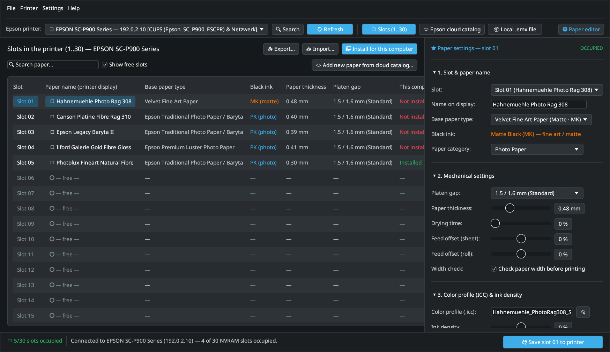
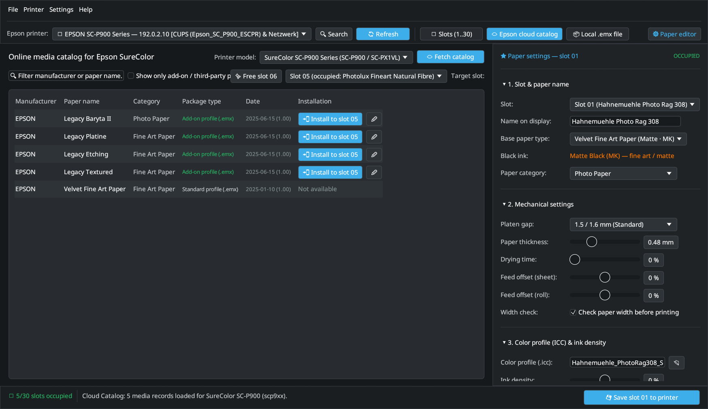
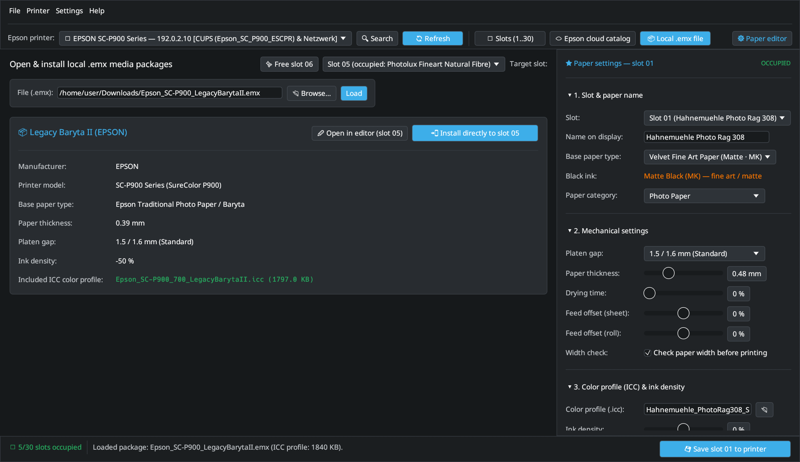

# 2. NVRAM Slots, Cloud Catalog & Local `.emx` Packages

This chapter describes the three workspace views of **EP Media Installer (`epmi-gui`)**, how to transfer your paper setup to a second computer, and how to troubleshoot connectivity issues.

---

## 1. Printer Slots (`🖨 Slots 1..30`) & Paper Settings Dock

The **🖨 Slots (1..30)** view displays all 30 user media slots stored in your printer's NVRAM alongside their local installation status on the current computer (**Installed** vs. **Not installed**).



Clicking any row opens that slot in the **★ Paper settings** dock on the right:

- **1. Slot & paper name:**
  - **Name on display:** Up to 28 UTF-16LE characters displayed on the printer's LCD panel when loading paper.
  - **Base paper type:** Determines the underlying driver look-up table (`base_sn_id`) and whether the printer uses **Matte Black (`MK`)** or **Photo Black (`PK`)** ink. Always match the base media specified in the paper manufacturer's handling instructions (e.g. *Velvet Fine Art Paper*, *Watercolor Paper - Radiant White*, *UltraSmooth Fine Art Paper*, *Premium Luster Photo Paper*, or *Traditional Photo Paper / Baryta*).
- **2. Mechanical settings:**
  - **Platen gap:** Head-to-paper clearance (`1.5 / 1.6 mm (Standard)`, `2.1 mm (Wide)`, `2.4 mm (Wider / Fine Art)`). Thick cotton rag and baryta papers (≥ `0.45 mm`) benefit from `Standard` or `Wide` to prevent head strikes.
  - **Paper thickness:** Physical caliper in millimeters (`0.01`–`1.50 mm`, stored in `0.01 mm` steps in NVRAM).
  - **Drying time & Feed offset:** Fine-tune inter-pass drying delay and micro-banding feed compensation (`-50%` to `+50%`).
  - **Width check:** Enable or disable the optical carriage width sensor before printing.
- **3. Color profile (ICC) & ink density:**
  - **Color profile (`.icc`):** Links a third-party or custom `.icc` / `.icm` profile to this slot. When you click **🖥 Install for this computer**, this profile is copied to `/usr/local/share/color/icc/epson-p900-custom/` and linked in `/etc/epson-p900-escpr-cups/custom_media.json` so **LumaPrint** selects it automatically whenever you pick this paper.
- **5. Technical details (expert view):**
  - Displays the 32-bit `user_media_id`, the driver slot ID (`1901`..`1930`), and the sanitized 32-character CUPS PPD key (`Slot01_...`).

---

## 2. Online Cloud Catalog (`☁ Epson cloud catalog`)

The **☁ Epson cloud catalog** view queries Epson's official `epson-media-installer` cloud repository over HTTPS for 27 SureColor printer models.



1. Choose your **Printer model** at the top right (automatically pre-selected when an SC-P900 or SC-P700 is connected) and click **☁ Fetch catalog**.
2. Filter the list by manufacturer or paper name, or enable **Show only add-on / third-party papers** to hide built-in standard papers.
3. Choose a **Target slot** (or click **✨ Free slot** to jump to the next unoccupied slot).
4. Click **📲 Install to slot** to download the `.emx` package, extract its mechanical parameters and `.icc` profile, and write the paper directly to the selected printer slot.

---

## 3. Local `.emx` Media Packages (`📦 Local .emx file`)

If a paper manufacturer provides a downloadable `.emx` file (or if you work offline), switch to **📦 Local .emx file**:



1. Click **📂 Browse…** and select the `.emx` file (or drag and drop it).
2. Inspect the extracted paper metadata (manufacturer, base paper type, thickness, platen gap, ink density, and embedded `.icc` color profile).
3. Click **📲 Install directly to slot** to write the paper to the chosen NVRAM slot and save the `.icc` profile in your working copy, or click **✏ Open in editor** to customize parameters before saving.

---

## 4. Using Custom Papers on Another Computer (`.epmi` Export / Import)

When you switch to a second Linux workstation on the same network, the printer already holds your custom papers in its NVRAM slots (`01`–`30`), so **you do not need to re-write the printer slots**.

- **If you only use Cloud Catalog papers:** On the second computer, open `epmi-gui`, connect to the printer, and click **🖥 Install for this computer**. `epmi` reads the slots from the printer and automatically downloads the matching `.icc` profiles from the cloud.
- **If you use third-party `.icc` profiles (Hahnemühle, Canson, Ilford, or custom calibration profiles):**
  1. On your first computer, click **📤 Export…** in the **🖨 Slots (1..30)** view to save a portable `.epmi` archive containing all slot definitions and `.icc` files.
  2. On your second computer, click **📥 Import…**, select the `.epmi` file, and click **🖥 Install for this computer**.

From the command line:

```bash
# On computer A:
epmi export --host 192.168.178.50 -o my-papers.epmi

# On computer B:
epmi import my-papers.epmi
epmi install-system --host 192.168.178.50
```

---

## 5. Troubleshooting

### Printer Not Found or SNMP Timeout (`UDP 161`)

- **Symptom:** `epmi list-slots` or `epmi-gui` reports an SNMP timeout or cannot discover the printer.
- **Cause:** Reading and writing NVRAM slots (`Slot 01`–`30`) uses **SNMPv1 over UDP port 161** (`community = "public"` for reading, `"private"` for writing). USB-only connections do not expose SNMP over IP unless bridged.
- **Fix:**
  1. Connect the printer via Wi-Fi or Ethernet and verify its IP address (`ping <printer-ip>`).
  2. Ensure SNMP is enabled in the printer's network configuration (Web Config → *Network Security* → *SNMP*).
  3. Allow outbound UDP port 161 in your local firewall if restricted.

### *"Install for this computer"* Fails Without a Password Prompt

- **Symptom:** Clicking *"Install for this computer"* in `epmi-gui` fails immediately with a Polkit / `pkexec` error.
- **Cause:** No graphical Polkit authentication agent (`polkit-kde-authentication-agent-1`, `polkit-gnome-authentication-agent-1`, or `lxpolkit`) is running in your desktop session.
- **Fix:** Start your desktop environment's Polkit agent, or run the system installation from a terminal:
  ```bash
  epmi install-system --host <PRINTER-IP>
  ```
