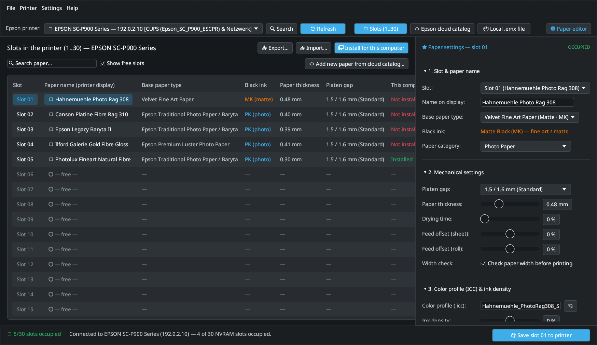

# EP Media Installer (`epmi`) — User Manual

**EP Media Installer (`epmi`)** is a native Linux desktop and command-line application for managing custom Fine-Art papers, `.emx` media packages, and hardware NVRAM slots (`Slot 01`–`30`) on **Epson SureColor** printers (especially the **SC-P900** and **SC-P700**).

It provides the complete Linux counterpart to Epson's Windows/macOS *Epson Media Installer* and integrates directly with the [**epson-p900-escpr-cups**](https://github.com/colorcube/epson-p900-escpr-cups) CUPS driver and [**LumaPrint**](https://github.com/colorcube/lumaprint).

---

## What Can EP Media Installer Do?

- **Read & Write All 30 Hardware NVRAM Slots (`Slot 01`–`30`):** Communicates directly with the printer over SNMPv1 (`UDP 161`, enterprise OID `1.3.6.1.4.1.1248.1.2.2.44.1.1.2.1`) to inspect, edit, and write mechanical paper parameters stored in the printer's non-volatile memory.
- **Mechanical Paper Parameters:** Configure paper display name (shown on the printer's touch screen), base media type (`PK` Photo Black vs. `MK` Matte Black), paper thickness (`0.01`–`1.50 mm`), platen gap (`Standard`, `Wide`, `Wider`, `Widest`), ink drying time, paper feed offset, and paper width check.
- **Online Cloud Media Catalog:** Browse and search official `.emx` media packages for 27 Epson SureColor series (`SC-P900`, `SC-P700`, `SC-P5300`, `SC-P6500`, `SC-P8500`, `SC-P7500`, `SC-P9500`, `SC-P20500`, and more) and install any paper + ICC profile into a printer slot with a single click.
- **Local `.emx` Package Unpacker:** Open downloaded `.emx` (`ZIP` / `CMSD`) packages from paper manufacturers (Hahnemühle, Canson, Ilford, Epson, Moab) to extract the embedded `.mcf` mechanical parameters and `.icc` color profile.
- **1-Click Computer Sync (*"Install for this computer"*):** Exports the printer's custom media slots and ICC profiles to `/etc/epson-p900-escpr-cups/custom_media.json` and `/usr/local/share/color/icc/epson-p900-custom/` and refreshes the CUPS PPDs so both CUPS and **LumaPrint** immediately offer every custom paper.
- **Multi-Computer `.epmi` Archive Export / Import:** Bundle custom paper definitions together with third-party ICC profiles into a portable `.epmi` archive to set up additional workstations in seconds.

---

## How Printer Slots and Computer Files Work Together

When you use custom Fine-Art papers on an Epson SureColor printer, information is stored in **two places**:

| Stored in the Printer (NVRAM Slots `01`–`30`) | Stored on Each Computer (`/etc/...` & `/usr/local/share/...`) |
| :--- | :--- |
| Paper display name (`Hahnemuehle Photo Rag 308`) | ICC color profile (`.icc` / `.icm`) in `/usr/local/share/color/icc/epson-p900-custom/` |
| Base media family (`Velvet Fine Art Paper` → `MK` Matte Black) | CUPS PPD media entries (`Slot01_Hahnemuehle_Photo_Rag_308`) |
| Paper thickness (`0.48 mm`) & Platen gap (`1.5 / 1.6 mm`) | `/etc/epson-p900-escpr-cups/custom_media.json` read by **LumaPrint** and the CUPS filter |
| Drying time, paper feed offset, and roll tension | Per-user working copy in `~/.config/epson-p900-escpr/custom_media.json` |

> [!IMPORTANT]
> The printer's NVRAM only stores **mechanical parameters** — it cannot store multi-megabyte ICC color profiles. Therefore, on every computer you print from, click **🖥 Install for this computer** once in `epmi-gui` so your computer has the matching CUPS PPD entries and ICC profiles.

---

## Manual Chapters

1. [**Quickstart & 1-Click Workflow**](1-quickstart-and-workflow.md) — Installing `epmi`, connecting to your printer, adding a new paper, and syncing with CUPS & LumaPrint.
2. [**NVRAM Slots, Cloud Catalog & Local `.emx` Packages**](2-printer-slots-and-cloud.md) — Detailed reference for the 30 slot editor, cloud catalog, `.emx` files, multi-computer `.epmi` archives, and troubleshooting.
